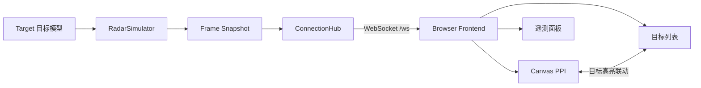

# RadarScope

**雷达目标仿真与高保真显控系统（初步版本）**

一个可运行的雷达目标仿真与 PPI 显控原型。后端使用 FastAPI 生成目标、推进目标运动并通过 WebSocket 推送实时快照；前端使用原生 Canvas 绘制军工赛博朋克风格的雷达盘、扫描扇区、目标点与航迹拖尾。

[在线仓库](https://github.com/YJY208277/special-fiesta)

## 项目阶段声明

> **当前状态：初步版本，算法仍在继续完善。**

本仓库目前完成的是雷达系统的**仿真数据链路和可视化显控原型**，不是完整的雷达探测与目标跟踪系统，也不能替代真实雷达软件。

- 已完成：目标生成、目标运动、WebSocket 实时推送、雷达盘显示、目标航迹、表格联动和自动重连。
- 下一阶段：雷达方程、SNR、检测概率、漏检、虚警、点迹生成和扫描判定。
- 后续完善：多目标关联、M/N 起批、卡尔曼滤波、航迹状态机和参数控制。

因此，本项目现阶段适合用于课程实践、功能演示和后续算法迭代，不应被表述为“所有雷达算法均已完成”。

## 项目状态

| 模块 | 状态 | 说明 |
| --- | --- | --- |
| 目标生成与运动 | 已完成 | 随机生成 5–8 个目标，距离 10–100 km，持续更新距离、方位和位置 |
| WebSocket 实时链路 | 已完成 | 连接后发送 `hello`，随后每 0.5 秒广播一帧 |
| FastAPI REST 接口 | 已完成 | 健康检查、配置、场景和当前快照 |
| Canvas 雷达盘 | 已完成 | 4 个距离环、方位刻度、十字准星、旋转扫描与余晖 |
| 目标显示与航迹 | 已完成 | 红色目标点、目标批号、最近 5 个位置形成的渐隐拖尾 |
| 表格与雷达联动 | 已完成 | 动态目标列表；悬浮行时对应目标放大并显示高亮光晕 |
| 自动重连与遥测 | 已完成 | WebSocket 指数退避重连、信号波形、扫描角与帧统计 |
| 雷达方程与 SNR/Pd | 规划中 | 计算最大探测距离、信噪比、检测概率和漏检 |
| 点迹与虚警 | 规划中 | 扫描过目标时生成带噪声点迹，并产生虚警 |
| 多目标跟踪 | 规划中 | 最近邻关联、M/N 起批、卡尔曼滤波和航迹状态机 |

## 功能特性

- **纯本地运行**：前端不依赖 npm、打包器或外部 CDN。
- **单端口部署**：FastAPI 同时提供 REST、WebSocket 和静态前端，默认访问 `127.0.0.1:8000`。
- **实时数据驱动**：前端不自行生成目标位置，目标真值由后端仿真时钟统一推进。
- **PPI 动态渲染**：Canvas 底图层、扫描扇区、余晖、航迹和目标点分层绘制。
- **状态联动**：目标表格与雷达画面通过目标批号关联，支持鼠标悬浮和点击选中。
- **链路健壮性**：慢连接发送超时、异常连接移除、前端断线后自动重连。
- **响应式桌面布局**：面向 1366×768 及以上桌面浏览器设计。

## 运行环境

- Windows 10 / 11
- Python 3.11 或更高版本
- Chrome / Edge 最新版

本项目已在 Python 3.14、FastAPI 0.165、Uvicorn 0.54 下验证。

## 快速启动

在项目根目录执行：

```powershell
python -m venv .venv
.\.venv\Scripts\Activate.ps1
pip install -r requirements.txt
uvicorn main:app --host 127.0.0.1 --port 8000 --reload
```

浏览器打开：

```text
http://127.0.0.1:8000
```

接口文档：

```text
http://127.0.0.1:8000/docs
```

如果 PowerShell 禁止激活脚本，可以临时执行：

```powershell
Set-ExecutionPolicy -Scope Process Bypass
```

## 系统架构



数据方向保持单一：

```text
Target → RadarSimulator → Snapshot → WebSocket → Frontend → Canvas / DOM
```

前端只负责插值、渲染和交互，不修改目标真值。

## 目录结构

```text
radarscope-step1/
├── main.py                 # FastAPI 入口、目标模型、仿真循环、WebSocket 与静态挂载
├── requirements.txt        # Python 依赖
├── README.md
└── frontend/
    ├── index.html          # 显控终端页面结构
    ├── style.css           # 军工赛博朋克主题与桌面布局
    └── app.js              # Canvas 渲染、WebSocket、航迹和 UI 联动
```

## 后端设计

### Target 目标模型

每个目标包含：

| 字段 | 单位 | 说明 |
| --- | --- | --- |
| `id` | - | 目标批号，例如 `TGT-001` |
| `distance` | km | 距离，初始范围为 10–100 km |
| `azimuth` | ° | 方位角，0° 为正北，顺时针为正 |
| `speed` | m/s | 目标速度 |
| `status` | - | 当前为 `ACTIVE` |
| `range_m` | m | 与 `distance` 对应的米制距离 |
| `x`, `y` | m | 局部东北平面坐标 |
| `hdg` | ° | 根据速度分量计算的航向 |

目标速度拆分为径向与切向分量。到达 10 km 或 100 km 边界后径向速度反向，使第一阶段演示中的目标保持在显示范围内。

### 仿真循环

服务启动时，FastAPI `lifespan` 创建异步仿真任务：

1. 使用单调时钟等待下一个 0.5 秒周期。
2. 根据实际经过时间推进全部目标。
3. 推进天线扫描角和扫描圈数。
4. 生成带递增 `seq` 的全量快照。
5. 广播给当前全部 WebSocket 客户端。

连接断开或客户端发送超时不会阻塞其他客户端。

## REST API

| 方法 | 路径 | 说明 |
| --- | --- | --- |
| `GET` | `/api/health` | 服务状态、运行时间、帧序号和连接数 |
| `GET` | `/api/config` | 雷达、显示和仿真配置 |
| `GET` | `/api/scenario` | 当前目标场景 |
| `GET` | `/api/snapshot` | 最近一帧完整快照 |
| `GET` | `/` | 静态雷达显控页面 |

## WebSocket 协议

连接地址：

```text
ws://127.0.0.1:8000/ws
```

连接建立后首先收到 `hello`：

```json
{
  "type": "hello",
  "server": "radarscope/1.0",
  "config": {
    "radar": {
      "rpm": 30,
      "range_km": 150
    }
  },
  "scenario": {
    "targets": []
  }
}
```

此后每 0.5 秒收到一帧 `frame`：

```json
{
  "type": "frame",
  "seq": 42,
  "sim_t": 21.0,
  "scan": {
    "az": 126.0,
    "rev": 10,
    "rpm": 30
  },
  "stats": {
    "targets": 7,
    "tracks": 0,
    "plots": 0,
    "tick_ms": 0.08
  },
  "targets": [
    {
      "id": "TGT-001",
      "distance": 67.32,
      "azimuth": 143.2,
      "speed": 318.5,
      "status": "ACTIVE",
      "range_m": 67320.0,
      "x": 40311.9,
      "y": -53917.2,
      "hdg": 206.7
    }
  ],
  "tracks": [],
  "plots": []
}
```

客户端可发送心跳：

```json
{
  "type": "ping",
  "ts": 1795500000000
}
```

服务端返回 `pong`。

## 坐标换算

雷达以自身为原点，使用局部东北平面：

```text
x = R × sin(azimuth)
y = R × cos(azimuth)
```

Canvas 的 y 轴向下，因此屏幕坐标为：

```text
screen_x = center_x + x × scale
screen_y = center_y - y × scale
```

方位角约定：

```text
0° = 正北
90° = 正东
180° = 正南
270° = 正西
```

## 默认雷达参数

| 参数 | 默认值 |
| --- | --- |
| 雷达名称 | CNRAD/SA-B.001 |
| 工作频段 | S 波段 |
| 工作频率 | 3.0 GHz |
| 峰值功率 | 1.5 MW |
| 天线增益 | 35 dB |
| 方位波束宽度 | 3.0° |
| 脉冲重复频率 | 1000 Hz |
| 天线转速 | 30 rpm |
| 显示量程 | 150 km |
| 目标显示范围 | 10–100 km |
| 数据更新周期 | 0.5 s |

## 前端实现

- 使用 `ResizeObserver` 与 `devicePixelRatio` 保持高分辨率 Canvas 清晰。
- 静态距离环和方位刻度先绘制到离屏 Canvas，再复用到动画帧。
- 扫描扇区由 46 个透明度递减的切片组成，形成旋转余晖。
- 每个目标维护最近 5 个位置，使用逐段透明度形成渐隐拖尾。
- 表格悬浮、键盘聚焦和点击选中都会驱动画布高亮。
- WebSocket 断开后使用 1、2、4、8 秒退避重连。

## 验证命令

健康检查：

```powershell
curl.exe http://127.0.0.1:8000/api/health
```

检查前端语法：

```powershell
node --check frontend/app.js
```

## 当前限制

- 当前显示的是模拟目标真值，不是经过雷达检测和跟踪后的航迹。
- 尚未实现雷达方程、Albersheim 检测概率、虚警、点迹和卡尔曼滤波。
- 天线扫描与目标数据当前以 0.5 秒周期更新，后续可根据架构升级到更高频率。
- 暂时只提供桌面端布局，不包含移动端适配。
- 尚无用户系统、数据库和真实雷达硬件接入。

## 后续路线

1. 实现雷达方程、SNR、检测概率与漏检模型。
2. 加入虚警点迹和量测噪声。
3. 实现波束跨越判定、点迹生成与扫描圈状态。
4. 实现最近邻关联、M/N 起批、航迹状态机。
5. 加入卡尔曼滤波与平滑外推。
6. 增加参数面板、暂停、倍速、量程切换与目标注入。
7. 补充单元测试、性能压测和演示录像。

## 说明

本项目用于雷达原理学习、课程实践和软件工程练习。模拟数据不用于真实空情判断或武器装备控制。
